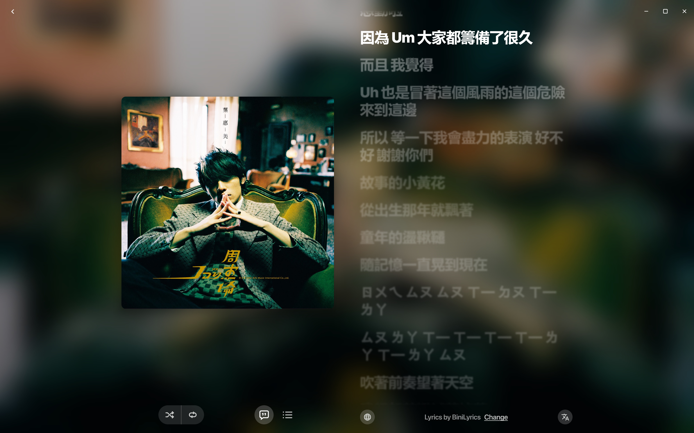
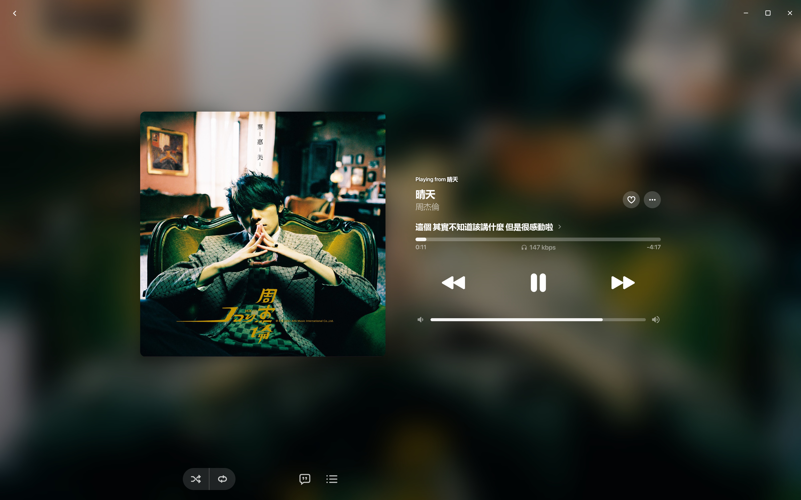

<div align="center">

<br/>
<br/>


# BitChord for Windows

### An Apple Music–styled YouTube Music client for Windows

<br/>

**English** · [简体中文](README_zh.md)

<br/>

[](https://github.com/xiongdy54/BitChord-for-Windows/releases)
[](https://github.com/xiongdy54/BitChord-for-Windows/blob/main/LICENSE)
[](https://github.com/xiongdy54/BitChord-for-Windows/releases)


<br/>

[**Download**](#download) · [**Features**](#features) · [**Screenshots**](#screenshots) · [**Build from source**](#build-from-source) · [**Acknowledgements**](#acknowledgements) · [**Disclaimer**](#disclaimer)

</div>

> [!IMPORTANT]
> BitChord for Windows is an independent, community-driven Windows port of the [BitChord](https://github.com/kushagrasinghx/BitChord) Android app. It is not affiliated with, endorsed by, or connected to YouTube or Google in any way. Use it at your own discretion.

---

<div align="center">

<h1><a id="screenshots"></a>Screenshots</h1>



<table>
  <tr>
    <td width="50%" align="center"><br/><sub><b>Listen Now</b> — your personalized home shelf</sub></td>
    <td width="50%" align="center"><br/><sub><b>Now Playing</b> — artwork-driven backdrop, stats for nerds</sub></td>
  </tr>
  <tr>
    <td width="50%" align="center"><br/><sub><b>Search</b> — filterable by songs, videos, albums, artists and playlists</sub></td>
    <td width="50%" align="center"><br/><sub><b>Local Music</b> — your own folders and WebDAV, in the same library</sub></td>
  </tr>
</table>

</div>

---

<div align="center">

<h1><a id="features"></a>Features</h1>

<table>
  <tr>
    <td width="50%" valign="top">

#### Playback
- **Search, browse and play** anything available on YouTube Music.
- **Hi-res lossless audio** — FLAC/ALAC from a configured module source, with YouTube Music as fallback.
- **Gapless playback with true crossfade**, adjustable 0–12s.
- **Offline downloads** — a download manager with pause/resume, your own destination folder, embedded metadata.
- **Local music library** integration — pick your folders, browse and sort them alongside streaming.
- **WebDAV** — stream your self-hosted library.
- **Autoplay** — the queue keeps itself topped up, radio-style.

#### Experience
- **Apple Music–inspired design** — frosted-glass sidebar and toolbar, translucent/Mica window modes, light & dark themes.
- **Word-synced lyrics** — word/syllable-level highlighting from multiple sources, with the Apple-like lyrics animation — credit to [binimum](https://github.com/binimum/am-lyrics).
- **Animated album canvas** — motion artwork on the now-playing screen.
- **Dynamic, artwork-driven theming** — palette extracted from album art.
- **English / 简体中文** — switch the language without a restart.

    </td>
    <td width="50%" valign="top">

#### Windows Integration
- **SMTC system media controls** — the taskbar/lock-screen media flyout, hardware media keys.
- **Output device picker** — route the sound to any device the system offers.
- **Per-app window** — a real desktop window: resizable, remembers its shape.

#### Controls & Tweaks
- **10-band equalizer** with presets, built on the playback engine itself.
- **Playback speed control** and **skip silence**.
- **Loudness normalization** and a **Dolby Atmos rendition preference**.
- **Sleep timer** — fixed presets or "stop after this track".
- **Stats for nerds** — codec, bit rate, sample rate, and more on the now-playing screen.

#### Accounts, Sources & Data
- **Sign in with your Google account** for personalized content.
- **Pluggable sources** — add, edit, test and health-check module sources.
- **Backup & restore** — your data exports to a file you own.
- **Built-in update checker** — the app checks GitHub Releases on launch and from Settings, and opens the release page for you when there is something newer.

    </td>
  </tr>
</table>

</div>

---

<div align="center">

<h1><a id="download"></a>Download</h1>

Grab the latest **MSI** or **EXE** installer from the [Releases](https://github.com/xiongdy54/BitChord-for-Windows/releases) page and install it like any Windows app.

> [!NOTE]
> Playback is powered by **libvlc**, which ships **inside the installer** since v0.2.0 — there is nothing else to install. (Releases before v0.2.0 need the [VLC media player](https://www.videolan.org/vlc/) on the machine.)

Windows 10 or 11, x64.

</div>

---

<div align="center">

<h1><a id="build-from-source"></a>Build from source</h1>

You need a **JDK 21** toolchain.

```bash
# run it straight from source
./gradlew -p desktop run

# or produce the installer
./gradlew -p desktop packageDistributionForCurrentOS
```

</div>

---

<div align="center">

<h1><a id="contributing"></a>Contributing</h1>

Issues and pull requests are welcome — this fork lives on its own, and the desktop port has plenty of rough edges worth sanding.

For the Android original, see upstream's [Contributing Guide](https://github.com/kushagrasinghx/BitChord/blob/main/CONTRIBUTING.md).

</div>

---

<div align="center">

<h1><a id="acknowledgements"></a>Acknowledgements</h1>

BitChord for Windows is a port of the Android app — none of it exists without the original:

- **[BitChord](https://github.com/kushagrasinghx/BitChord)** by [@kushagrasinghx](https://github.com/kushagrasinghx) — the Android original. If this Windows build earns a spot in your rotation, go star the upstream.
- **[binimum/am-lyrics](https://github.com/binimum/am-lyrics)** — the Apple-style lyrics animation this project's lyrics view follows.
- **[InnerTubeX](https://github.com/MetrolistGroup/innertubex)**, **[NewPipe Extractor](https://github.com/TeamNewPipe/NewPipeExtractor)** — the YouTube Music data layer.
- **libvlc / [vlcj](https://github.com/caprica/vlcj)**, **[JCEF](https://github.com/jcefmaven/jcefmaven)**, **[Haze](https://github.com/chrisbanes/haze)**, **[Compose Multiplatform](https://github.com/JetBrains/compose-multiplatform)** — playback, sign-in, glass, and the whole UI.

</div>

---

<div align="center">

<h1><a id="disclaimer"></a>Disclaimer & Legal Notice</h1>

BitChord is an independent, community-driven third-party audio player and client. It is **not** associated with Google LLC, YouTube Music, or any of their parent companies.

* **No Media Hosting:** BitChord does not host, upload, or store copyrighted music files. It operates strictly as an interface to scan local storage or stream media directly from public, public-facing, or user-authenticated APIs.
* **Fair Use & API Usage:** This software is created solely for personal research, educational, and fair-use purposes. The user is entirely responsible for ensuring their usage aligns with their local copyright laws and YouTube Terms of Service.
* **No Ad-Blocking Guarantee:** While BitChord focuses on providing a clean listening environment, it does not guarantee permanent bypasses or modifications to commercial third-party platform conditions.
* **Copyleft:** BitChord is free software under the GPLv3. The license does not let anyone forbid others from selling or redistributing copies, but any distribution must come with the Corresponding Source under the same license.

</div>

---

<div align="center">

<h1><a id="license"></a>License</h1>

This project is licensed under the **GNU General Public License v3.0 (GPLv3)**. See the [LICENSE](LICENSE) file for details.

</div>
