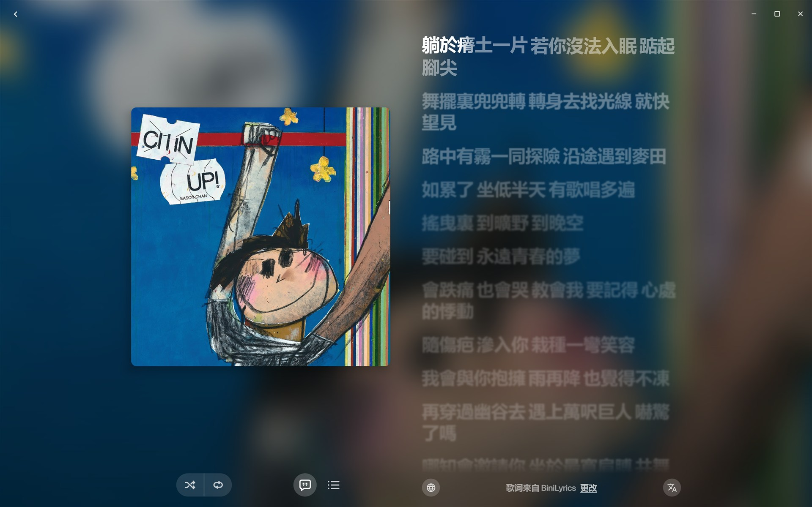
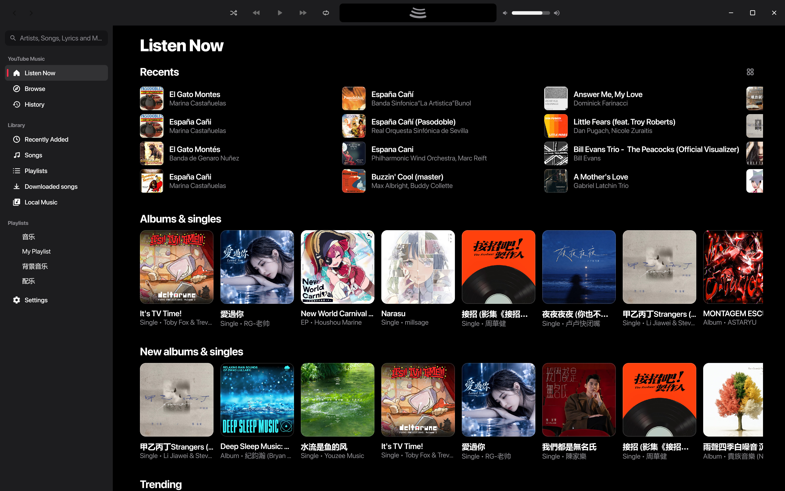
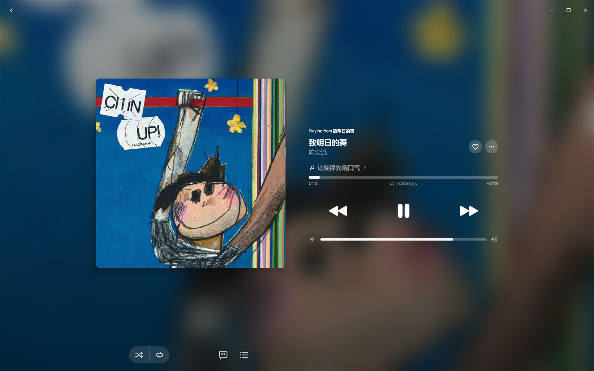
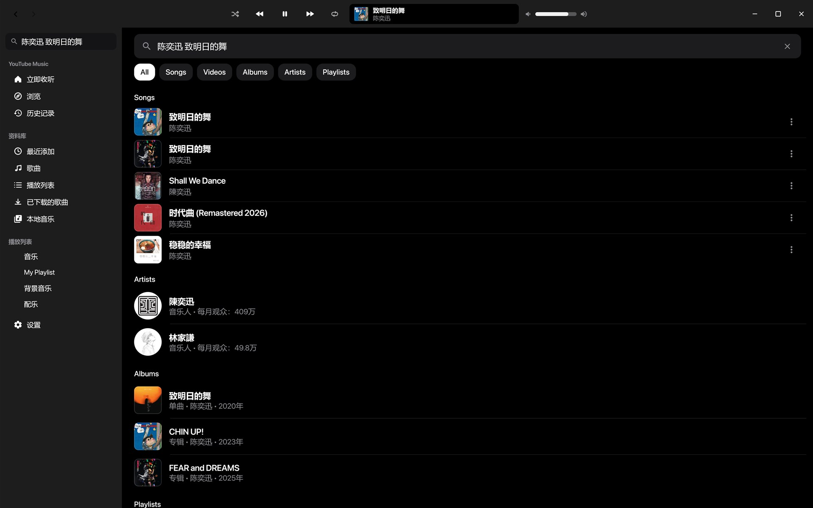
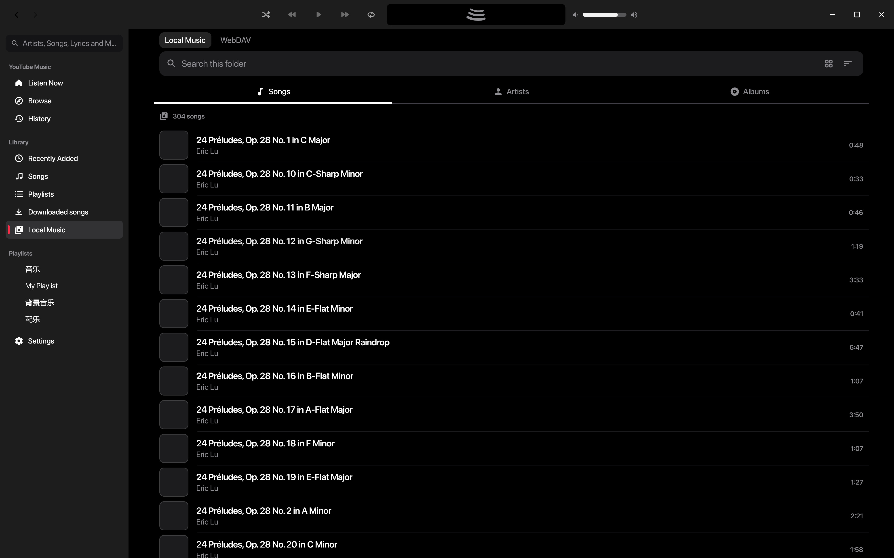

<div align="center">

<br/>
<br/>


# BitChord for Windows

### 一款仿 Apple Music 风格的 Windows 端 YouTube Music 客户端

<br/>

[English](README.md) · **简体中文**

<br/>

[](https://github.com/xiongdy54/BitChord-for-Windows/releases)
[](https://github.com/xiongdy54/BitChord-for-Windows/blob/main/LICENSE)
[](https://github.com/xiongdy54/BitChord-for-Windows/releases)


<br/>

[**下载**](#下载) · [**功能特性**](#功能特性) · [**截图**](#截图) · [**从源码构建**](#从源码构建) · [**致谢**](#致谢) · [**免责声明**](#免责声明)

</div>

> [!IMPORTANT]
> BitChord for Windows 是 [BitChord](https://github.com/kushagrasinghx/BitChord) 安卓应用的独立社区移植版，与 YouTube 或 Google 没有任何关联、背书或合作关系。请自行斟酌使用。

---

<div align="center">

<h1><a id="截图"></a>截图</h1>



<table>
  <tr>
    <td width="50%" align="center"><br/><sub><b>立即收听</b> — 为你推荐的首页内容</sub></td>
    <td width="50%" align="center"><br/><sub><b>正在播放</b> — 封面驱动的动态背景、极客数据</sub></td>
  </tr>
  <tr>
    <td width="50%" align="center"><br/><sub><b>搜索</b> — 可按歌曲、视频、专辑、艺人、播放列表过滤</sub></td>
    <td width="50%" align="center"><br/><sub><b>本地音乐</b> — 你自己的文件夹与 WebDAV，同一个资料库</sub></td>
  </tr>
</table>

</div>

---

<div align="center">

<h1><a id="功能特性"></a>功能特性</h1>

<table>
  <tr>
    <td width="50%" valign="top">

#### 播放
- **搜索、浏览并播放** YouTube Music 上的全部内容。
- **Hi-Res 无损音频** — 通过可配置的模块音源获取 FLAC/ALAC，YouTube Music 作为回退。
- **无缝播放与真正的交叉淡入淡出**，0–12 秒可调。
- **离线下载** — 下载管理器支持暂停/继续，下载文件夹由你指定，并写入内嵌元数据。
- **本地音乐库** — 自选文件夹，与流媒体内容并列浏览、排序。
- **WebDAV** — 直接串流你自建的NAS曲库。
- **自动续播（Autoplay）** — 电台式队列，播完自动补上。

#### 界面体验
- **仿 Apple Music 的设计** — 毛玻璃侧栏与工具栏、透明/Mica 窗口模式、浅色与深色主题。
- **逐字同步歌词** — 多歌词源、字/音节级高亮，Apple 风格歌词动画 — 致谢 [binimum](https://github.com/binimum/am-lyrics)。
- **动态专辑画布** — 正在播放页面的动效封面。
- **封面驱动的动态主题** — 从专辑封面提取配色。
- **中文 / English** — 随时切换语言，无需重启。

    </td>
    <td width="50%" valign="top">

#### Windows 集成
- **SMTC 系统媒体控件** — 任务栏/锁屏的媒体浮层、键盘媒体键。
- **输出设备选择器** — 把声音路由到系统提供的任何设备。
- **真正的桌面窗口** — 可调整大小，并记住上次的形状。

#### 控制与微调
- **十段均衡器**，带预设，直接构建在播放引擎之上。
- **播放速度调节**与**跳过静音**。
- **响度归一化**与 **Dolby Atmos（杜比全景声）版本偏好**。
- **睡眠定时器** — 固定预设，或"播完这首就停"。
- **极客数据（Stats for nerds）** — 编解码器、比特率、采样率等，就在正在播放页上。

#### 账号、音源与数据
- **登录 Google 账号**，获取个性化内容。
- **可插拔音源** — 添加、编辑、测试并健康检查模块音源。
- **备份与恢复** — 你的数据可以导出成你自己保存的文件。
- **内置更新检查** — 应用在启动时以及从设置中检查 GitHub Releases，有新版本时会为你打开发布页。

    </td>
  </tr>
</table>

</div>

---

<div align="center">

<h1><a id="下载"></a>下载</h1>

从 [Releases](https://github.com/xiongdy54/BitChord-for-Windows/releases) 页面获取最新的 **MSI** 或 **EXE** 安装包，像普通 Windows 应用一样安装即可。

> [!NOTE]
> 播放由 **libvlc** 驱动，自 v0.2.0 起 **libvlc 随安装包分发**——无需安装任何额外软件。（v0.2.0 之前的版本需要机器上装有 [VLC media player](https://www.videolan.org/vlc/)。）

支持 Windows 10 / 11（x64）。

</div>

---

<div align="center">

<h1><a id="从源码构建"></a>从源码构建</h1>

需要 **JDK 21** 工具链。

```bash
# 直接从源码运行
./gradlew -p desktop run

# 或生成安装包
./gradlew -p desktop packageDistributionForCurrentOS
```

</div>

---

<div align="center">

<h1><a id="贡献"></a>参与贡献</h1>

欢迎提交 Issue 和 Pull Request — 这个 fork 独立维护，桌面移植版还有不少值得打磨的地方。

安卓原版请参阅上游的[贡献指南](https://github.com/kushagrasinghx/BitChord/blob/main/CONTRIBUTING.md)。

</div>

---

<div align="center">

<h1><a id="致谢"></a>致谢</h1>

BitChord for Windows 是安卓应用的移植版 — 没有原版就没有它：

- **[BitChord](https://github.com/kushagrasinghx/BitChord)** by [@kushagrasinghx](https://github.com/kushagrasinghx) — 安卓原版。如果这个 Windows 版也在你的常驻播放器里占了一席之地，请去给上游点个 Star。
- **[binimum/am-lyrics](https://github.com/binimum/am-lyrics)** — 本项目歌词视图所效仿的 Apple 风格歌词动画。
- **[InnerTubeX](https://github.com/MetrolistGroup/innertubex)**、**[NewPipe Extractor](https://github.com/TeamNewPipe/NewPipeExtractor)** — YouTube Music 数据层。
- **libvlc / [vlcj](https://github.com/caprica/vlcj)**、**[JCEF](https://github.com/jcefmaven/jcefmaven)**、**[Haze](https://github.com/chrisbanes/haze)**、**[Compose Multiplatform](https://github.com/JetBrains/compose-multiplatform)** — 播放、登录、毛玻璃与整个界面。

</div>

---

<div align="center">

<h1><a id="免责声明"></a>免责声明与法律须知</h1>

BitChord 是一款独立的、由社区驱动的第三方音频播放器与客户端。它与 Google LLC、YouTube Music 及其任何母公司**均无关联**。

* **不托管任何媒体文件：** BitChord 不托管、不上传、不存储任何受版权保护的音乐文件。它仅作为一个界面，扫描本地存储，或直接从公开的、面向公众的、或经用户授权的 API 串流媒体。
* **合理使用与 API 使用：** 本软件仅用于个人研究、教育与合理使用目的。用户须自行确保其使用符合当地版权法与 YouTube 服务条款。
* **不保证屏蔽广告：** 虽然 BitChord 致力于提供干净的收听环境，但它不保证对第三方商业平台条件的永久绕过或修改。
* **Copyleft：** BitChord 是基于 GPLv3 的自由软件。该许可证不禁止任何人出售或再分发副本，但任何分发都必须附带同一许可证下的完整对应源代码。

</div>

---

<div align="center">

<h1><a id="许可证"></a>许可证</h1>

本项目基于 **GNU General Public License v3.0（GPLv3）** 授权，详见 [LICENSE](LICENSE) 文件。

</div>
